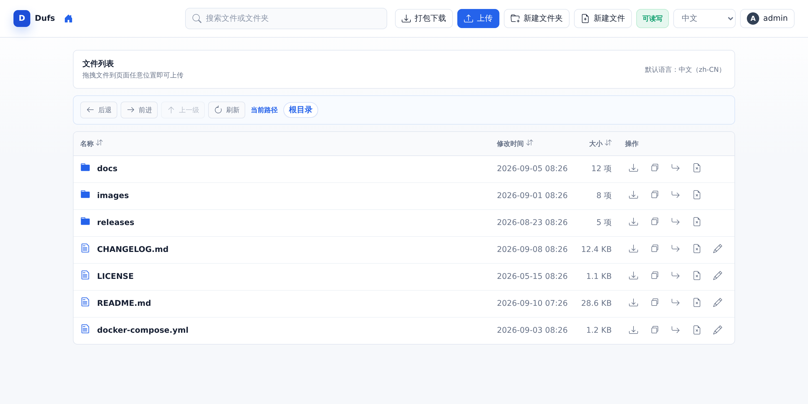
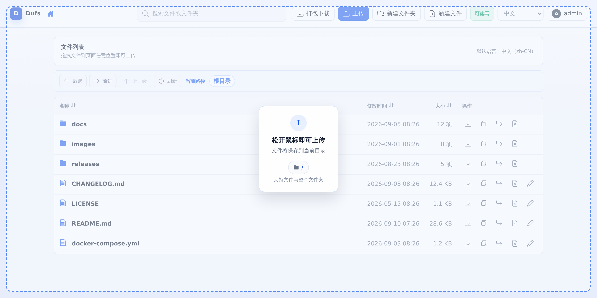
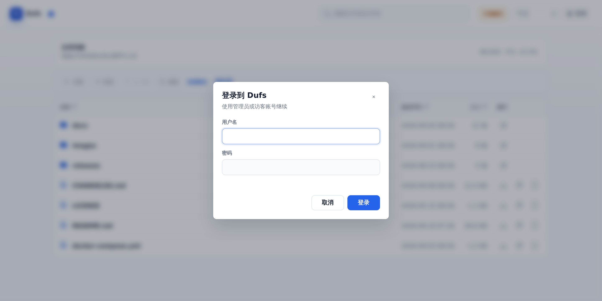
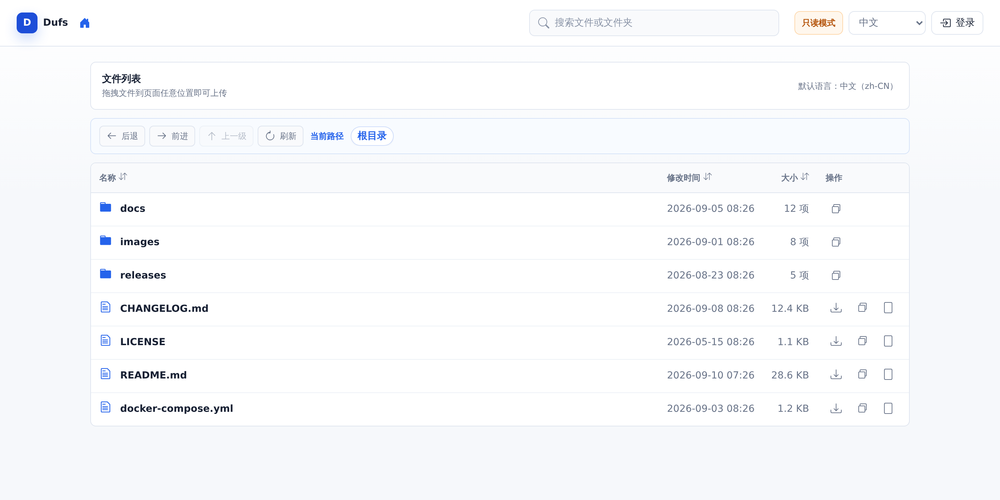
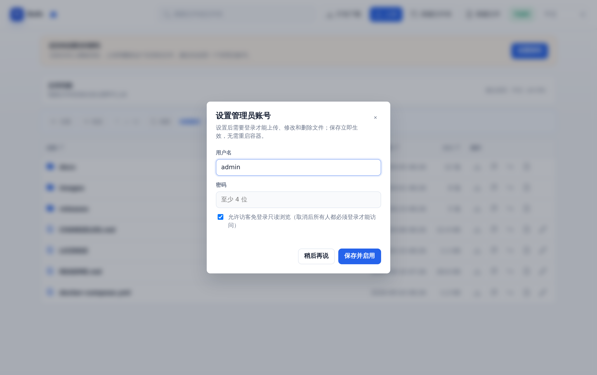
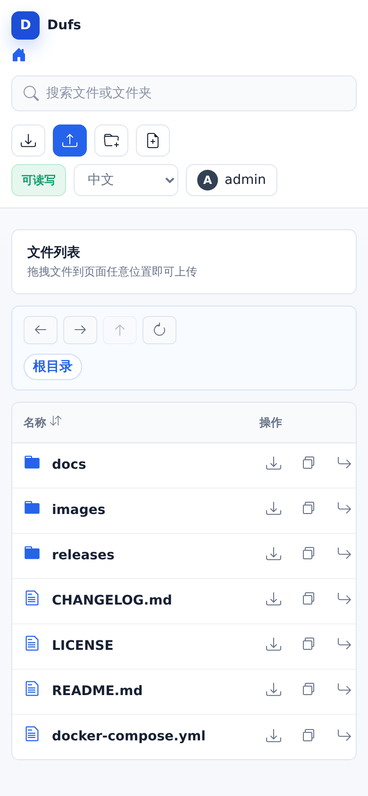

<div align="center">
  
  <h1>Dufs 中文增强版</h1>
  <p>轻量级网页文件管理器与 WebDAV 服务器 · 中文优先界面</p>
  <p>基于 <a href="https://github.com/sigoden/dufs">sigoden/dufs</a> 二次开发，单文件静态二进制、零运行时依赖，Docker 一条命令即可运行。</p>
  <p>
    
    
    
    
  </p>
  <p>
    
    
    
    
  </p>
</div>

## 项目简介

Dufs 可以把任意目录变成一个网页文件服务器：浏览器里直接浏览、上传、搜索、编辑、打包下载，也可以作为 WebDAV 网盘挂载到系统里使用。

本仓库是 Dufs 的中文增强版，在官方 `0.46.0` 的基础上重做了整套中文优先界面，并补充了网页初始化管理员、访客范围设置等交互细节。程序编译为单个静态二进制（scratch 镜像约 10 MB），没有运行时依赖，非常适合放进家庭 NAS、内网服务器或随身小主机。

除界面增强外，本版本还回合了上游全部安全修复，并对二开引入的管理员初始化功能做了系统性的安全加固（凭据文件原子写盘、初始化防植入、会话权限校验等），详见 [CHANGELOG](./CHANGELOG.md)。

## 界面预览

<table>
  <tr>
    <td align="center"><strong>文件列表</strong><br></td>
    <td align="center"><strong>拖拽上传提示</strong><br></td>
    <td align="center"><strong>登录</strong><br></td>
  </tr>
  <tr>
    <td align="center"><strong>访客只读视图</strong><br></td>
    <td align="center"><strong>首次设置访问密码</strong><br></td>
    <td align="center"><strong>移动端</strong><br></td>
  </tr>
</table>

## 与上游的差异

| 项目 | 上游 dufs | 本仓库 |
| --- | --- | --- |
| 界面语言 | 英文 | 中文优先，可切换中 / 英 |
| 界面风格 | 原生简洁 | 重新设计：卡片式布局、顶部工具栏、路径导航、权限状态徽章 |
| 拖拽上传 | 支持，无视觉反馈 | 支持，拖入页面时显示全屏范围提示层，并标明目标目录 |
| 账号设置 | 只能用 `-a` 参数或配置文件 | 额外支持**网页首次初始化**：未配置账号时页面提示设置密码，写盘后立即生效 |
| 访客管理 | — | 设置页可视化调整访客可见范围（仅公开目录 / 全站只读 / 完全禁止） |
| 安全加固 | 0.46.0 版本基线 | 回合上游全部安全修复，并加固凭据文件、初始化流程与会话校验 |

## 功能特性

- 静态文件浏览和下载
- 文件夹打包为 zip 下载（保留空目录）
- 上传文件和文件夹，支持拖拽上传（拖入页面时显示范围提示与目标目录）
- 创建、编辑、搜索文件
- 断点上传和断点下载
- 账号访问控制，支持网页首次初始化管理员账号（无需改启动参数）
- 访客可见范围设置：仅公开目录 / 全站只读 / 完全禁止
- HTTPS 支持
- WebDAV 支持
- 可通过 Docker、二进制文件或 Cargo 安装

## Docker 快速开始

镜像已内置默认端口、数据目录与权限开关，**不需要记任何参数**。

配置与文件**完全分开**存放，挂载目录下会有两个子目录：

```
$PWD（挂载到 /data）
├── config/   ← 管理员配置（dufs 专用，别放分享文件）
└── files/    ← 分享的文件（对外可见的全部内容）
```

先从Releases下载对应架构的镜像包（`dufs-docker-amd64-<版本>.tar.gz` 或 `dufs-docker-arm64-<版本>.tar.gz`），加载后运行：

```
docker load -i dufs-docker-amd64-v1.2.0.tar.gz
mkdir -p files
docker run --rm -p 5000:5000 -v "$PWD:/data" dufs:v1.2.0
```

把要分享的文件放进 `files/`，打开浏览器访问 `http://127.0.0.1:5000/`，即可浏览、上传、下载、搜索和打包下载文件。

> `config/` 会在首次初始化管理员时自动创建；分享的文件永远放 `files/` 里，宿主机上整理文件不会碰到配置。

还没有镜像包时，可以先本地构建：

```
docker build -t dufs .
docker run --rm -p 5000:5000 -v "$PWD:/data" dufs
```

多架构镜像包（`linux/amd64`、`linux/arm64`）由 GitHub Actions 手动构建：仓库页 → Actions → **docker-publish** → Run workflow 并填写版本标签（如 `v1.2.0`），两个架构的镜像包会自动附加到对应的 Release 上。

### 首次访问：在网页上设置密码（推荐）

容器启动后如果没有通过 `-a` 指定任何账号，页面顶部会出现提示条，点「设置密码」就能创建管理员账号：

- 自定义用户名与密码，密码以 **sha-512 加盐哈希** 保存到 `config/admin.json`（与分享文件完全分开，文件权限 0600，原子写盘）
- 选择**访客可见范围**：仅公开目录 `/public`（推荐）/ 全站只读 / 完全禁止
- 「允许通过完整链接直接访问文件」（匿名直链）**默认关闭**，开启后知道完整文件链接的人可以绕过目录限制直接打开单个文件，可在设置页随时调整
- 保存后**立即生效，无需重启容器**，之后初始化入口自动关闭（再次访问返回 401/403）
- 命令行 `-a` / 配置文件优先级更高，配置过就不会再出现设置提示

> 公网环境建议**先设置密码，再对外映射端口**。初始化采用「先到先得」，暴露端口前完成设置最稳妥。

### 可选：自定义启动参数

镜像内置 `CMD ["/data", "-A"]`，默认已开启上传、删除、搜索与打包下载，**以下两种场景才需要自己填命令**：

只想做**只读分享**（禁止任何修改），在命令栏填 `/data` 覆盖默认值：

```
docker run --rm -p 5000:5000 -v "$PWD:/data" dufs:v1.2.0 /data
```

不想用网页初始化、要**直接固定账号密码**，在命令栏填账号规则：

```
docker run --rm -p 5000:5000 -v "$PWD:/data" dufs:v1.2.0 \
  -a admin:你的密码@/:rw \
  -a guest:你的密码@/
```

## 安全须知

- 管理员配置保存在独立的 `config/` 目录（Docker 内为 `/data/config`，二进制运行默认 `~/.config/dufs`，可用 `--config-dir` 自定义），其中 `admin.json` 保存密码的 sha-512 加盐哈希，文件权限 0600。配置目录**不在分享范围内**，不会出现在文件列表、也无法通过 HTTP 读取；配置损坏时服务会拒绝启动并给出提示（fail-closed），按提示修复或删除后重新初始化即可。`config/` 里请勿存放想分享的文件。
- 「仅公开目录」模式下，访客只能浏览 `/public` 的目录结构。如需把单个文件的直链分享给他人，可在设置页开启「允许通过完整链接直接访问文件」——开启后**任何知道完整路径的人都能直接下载对应文件**，请确认路径中不含敏感文件。
- 上传的 HTML/SVG 文件会按原类型内联展示（方便托管静态页面）。如果访客可以匿名上传，请注意存储型 XSS 的风险：要么关闭匿名上传，要么不要在同一浏览器里用管理员身份浏览不受信任的上传内容。
- 对公网提供服务的额外建议：开启 HTTPS（`--tls-cert` / `--tls-key`，会话 Cookie 会自动附加 `Secure`）、限制 `--bind` 地址、按需收紧 `-A` 权限。

## 安装方式

**Docker**（推荐）：见上文，或自行构建 `docker build -t dufs .`

**二进制**：在 [Releases](https://github.com/aisubing/dufs-fileserver/releases) 下载对应平台的压缩包（打 `v*` tag 后由 CI 自动构建）

**Cargo**：

```
cargo install --path .
dufs ./data
```

命令行完整用法见 `dufs --help`。

## 致谢

- 上游项目：[sigoden/dufs](https://github.com/sigoden/dufs)。本仓库基于其 `0.46.0` 版本二次开发，并回合了上游后续的安全与缺陷修复，感谢原作者与所有贡献者。
- 界面文案、图标与交互沿用上游的 MIT / Apache-2.0 授权，二次开发的部分同样遵循该授权。

## 许可证

Copyright (c) 2022-2024 dufs-developers.

Dufs 可以在 MIT License 或 Apache License 2.0 中任选其一使用。

许可证详情见 `LICENSE-APACHE` 和 `LICENSE-MIT`。
